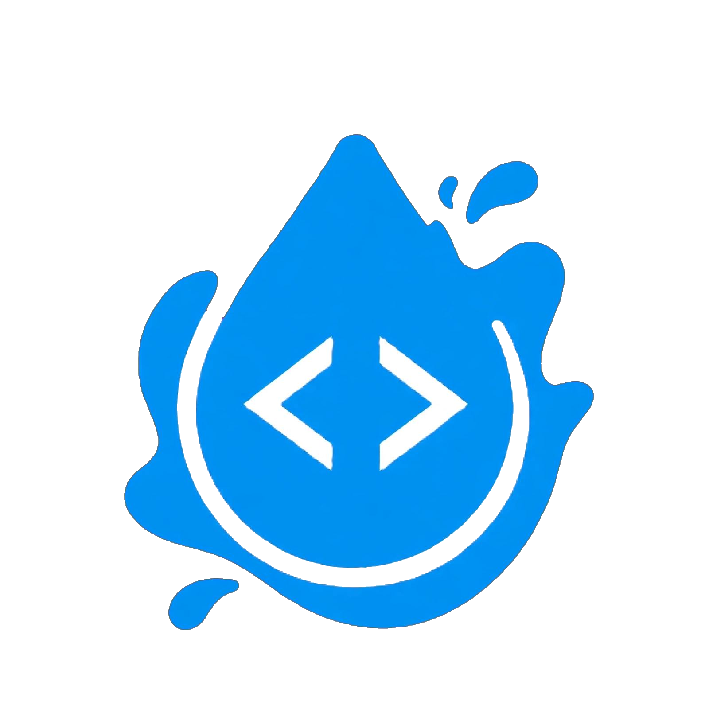

  
  &nbsp;&nbsp;&nbsp;
  

<h1 align="center">Splash Code Studio (SC)</h1>

Türk geliştirici tarafından geliştirildi. Sparky Family ürünü.

  

---

## [TR] - Türkçe

### Nedir?
Splash Code Studio, kod yazmayı hızlı ve eğlenceli hale getiren hafif bir IDE / kod editörüdür.

### Özellikler
- ⚡ Hızlı açılış, hafif yapı
- 🎨 Sade ve şık arayüz
- 📂 Dosya yönetimi ve proje desteği
- 🖥 Pek çok dil desteği ile geliştirme

### Kurulum
1. `Releases` kısmından en son `.exe` dosyasını indir.
2. Çift tıkla, çalıştır.
3. Kod yazmaya başla!

### Lisans
Bu proje **PolyShield License v1.0** ile korunmaktadır. Detaylar için `LICENSE` dosyasına bak.

---

## [ENG] - English

### What is it?
Splash Code Studio is a fast and lightweight IDE / code editor that makes coding fast and fun.

### Features
- ⚡ Fast startup, lightweight structure
- 🎨 Clean and stylish interface
- 📂 File management and project support
- 🖥 Development with support for many programming languages

### Installation
1. Download the latest `.exe` from `Releases`.
2. Double-click and run.
3. Start coding!

### License
This project is protected by **PolyShield License v1.0**. See `LICENSE` file for details.

---

**Sparky Family - PolyShield**
